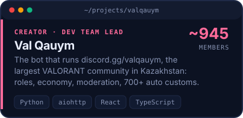
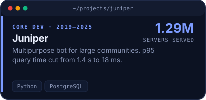
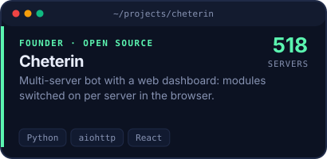
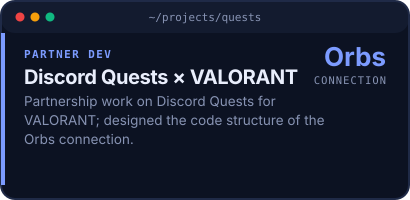
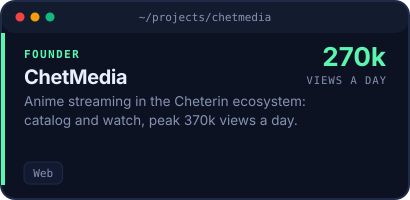
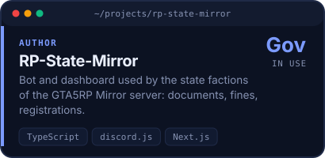
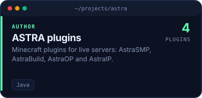
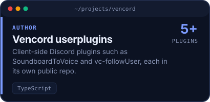
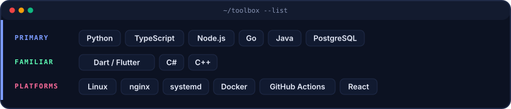

<picture>
  <source media="(prefers-color-scheme: dark)" srcset="https://raw.githubusercontent.com/Nanda070/Nanda070/main/assets/dark.svg?v=1">
  <source media="(prefers-color-scheme: light)" srcset="https://raw.githubusercontent.com/Nanda070/Nanda070/main/assets/light.svg?v=1">
  
</picture>

<p align="center">
  <a href="https://adnan070.me"><b>adnan070.me</b></a> — drive a robot through my projects
  &nbsp;·&nbsp; <a href="https://adnan070.me/resume">resume</a>
  &nbsp;·&nbsp; <a href="https://t.me/nanda070">telegram</a>
  &nbsp;·&nbsp; <a href="https://discord.com/users/1219803151180370021">discord</a>
  &nbsp;·&nbsp; <a href="mailto:adnan.huseynli1@gmail.com">email</a>
</p>

```console
$ whoami
adnan · nanda · backend developer · budapest, hungary

$ cat now.txt
studying   computer science at ELTE (2026 – 2029)
open to    part-time backend / platform roles · hungary · eu · remote · up to 30 h/week
into       database performance · bot architecture · community infrastructure
speaking   azerbaijani · russian · german (C1) · english (B2) · turkish (B2)
```

## Projects

<p align="center">
  <a href="https://valqauym.kz"><picture><source media="(prefers-color-scheme: dark)" srcset="https://raw.githubusercontent.com/Nanda070/Nanda070/main/assets/cards/valqauym-dark.svg?v=1"><source media="(prefers-color-scheme: light)" srcset="https://raw.githubusercontent.com/Nanda070/Nanda070/main/assets/cards/valqauym-light.svg?v=1"></picture></a>
  <a href="https://juniper.bot"><picture><source media="(prefers-color-scheme: dark)" srcset="https://raw.githubusercontent.com/Nanda070/Nanda070/main/assets/cards/juniper-dark.svg?v=1"><source media="(prefers-color-scheme: light)" srcset="https://raw.githubusercontent.com/Nanda070/Nanda070/main/assets/cards/juniper-light.svg?v=1"></picture></a>
  <a href="https://github.com/Nanda070/Cheterin-Bot"><picture><source media="(prefers-color-scheme: dark)" srcset="https://raw.githubusercontent.com/Nanda070/Nanda070/main/assets/cards/cheterin-dark.svg?v=1"><source media="(prefers-color-scheme: light)" srcset="https://raw.githubusercontent.com/Nanda070/Nanda070/main/assets/cards/cheterin-light.svg?v=1"></picture></a>
  <a href="https://adnan070.me/work"><picture><source media="(prefers-color-scheme: dark)" srcset="https://raw.githubusercontent.com/Nanda070/Nanda070/main/assets/cards/quests-dark.svg?v=1"><source media="(prefers-color-scheme: light)" srcset="https://raw.githubusercontent.com/Nanda070/Nanda070/main/assets/cards/quests-light.svg?v=1"></picture></a>
  <a href="https://chetmedia.com"><picture><source media="(prefers-color-scheme: dark)" srcset="https://raw.githubusercontent.com/Nanda070/Nanda070/main/assets/cards/chetmedia-dark.svg?v=1"><source media="(prefers-color-scheme: light)" srcset="https://raw.githubusercontent.com/Nanda070/Nanda070/main/assets/cards/chetmedia-light.svg?v=1"></picture></a>
  <a href="https://github.com/Nanda070/RP-State-Mirror"><picture><source media="(prefers-color-scheme: dark)" srcset="https://raw.githubusercontent.com/Nanda070/Nanda070/main/assets/cards/rp-state-mirror-dark.svg?v=1"><source media="(prefers-color-scheme: light)" srcset="https://raw.githubusercontent.com/Nanda070/Nanda070/main/assets/cards/rp-state-mirror-light.svg?v=1"></picture></a>
  <a href="https://github.com/Nanda070/AstraSMP"><picture><source media="(prefers-color-scheme: dark)" srcset="https://raw.githubusercontent.com/Nanda070/Nanda070/main/assets/cards/astra-dark.svg?v=1"><source media="(prefers-color-scheme: light)" srcset="https://raw.githubusercontent.com/Nanda070/Nanda070/main/assets/cards/astra-light.svg?v=1"></picture></a>
  <a href="https://cheterin.online/lookup/plugins"><picture><source media="(prefers-color-scheme: dark)" srcset="https://raw.githubusercontent.com/Nanda070/Nanda070/main/assets/cards/vencord-dark.svg?v=1"><source media="(prefers-color-scheme: light)" srcset="https://raw.githubusercontent.com/Nanda070/Nanda070/main/assets/cards/vencord-light.svg?v=1"></picture></a>
</p>

<p align="center"><sub>also: <a href="https://cheterin.online/lookup/">Discord Lookup</a> · <a href="https://github.com/Nanda070/Neptun-ELTE">Neptun ELTE</a> · <a href="https://github.com/Nanda070/Lumen">Lumen</a> — and all of it as pillars in the 3D lab on <a href="https://adnan070.me">adnan070.me</a></sub></p>

## Toolbox

<p align="center">
  <a href="https://adnan070.me/resume"><picture><source media="(prefers-color-scheme: dark)" srcset="https://raw.githubusercontent.com/Nanda070/Nanda070/main/assets/toolbox-dark.svg?v=1"><source media="(prefers-color-scheme: light)" srcset="https://raw.githubusercontent.com/Nanda070/Nanda070/main/assets/toolbox-light.svg?v=1"></picture></a>
</p>

## Activity

<picture>
  <source media="(prefers-color-scheme: dark)" srcset="https://raw.githubusercontent.com/Nanda070/Nanda070/output/github-contribution-grid-snake-dark.svg" />
  <source media="(prefers-color-scheme: light)" srcset="https://raw.githubusercontent.com/Nanda070/Nanda070/output/github-contribution-grid-snake.svg" />
  
</picture>

<p align="center">
  
</p>
