<picture>
  <source media="(prefers-color-scheme: dark)" srcset="https://raw.githubusercontent.com/Nanda070/Nanda070/main/assets/dark.svg?v=1">
  <source media="(prefers-color-scheme: light)" srcset="https://raw.githubusercontent.com/Nanda070/Nanda070/main/assets/light.svg?v=1">
  
</picture>

  
    
  
  &nbsp;
  

### 👋 About me

- 🛠️ **Backend developer** based in **Budapest, Hungary**: services, databases and the platforms around them
- 🎯 Creator and development lead of **[Val Qauym](https://valqauym.kz)**: bot, site, admin panel and economy of a VALORANT community in Kazakhstan
- 📈 Former core developer of **Juniper** (2019–2025): 1.29M servers served, p95 query time cut from 1.4 s to 18 ms
- 🤖 Founder of **Cheterin**, an open-source multi-server bot platform with a web dashboard
- 🎓 Computer Science at **ELTE**; open to part-time backend / platform roles in Hungary, the EU or remote

### 🚀 Featured projects

| Project | What it does | Stack |
|---|---|---|
| [**Val Qauym**](https://valqauym.kz) | Bot (~33 modules), site and admin panel for a ~945-member VALORANT server: 5v5 customs with seasonal Elo, economy, tournaments, browser game events | Python · aiohttp · React · TypeScript |
| [**Juniper**](https://juniper.bot) | Multipurpose Discord bot: **1,291,495** servers, **198M+** commands; p95 **1.4 s → 18 ms**, peak DB CPU **85% → 15%** | Python · discord.py · PostgreSQL |
| [**Cheterin**](https://github.com/Nanda070/Cheterin-Bot) | Public multi-server bot with a web dashboard, on **518** servers; Apache-2.0 | Python · aiohttp · React (Vite) |
| **Discord Quests × VALORANT** | Partner work on Discord Quests: designed the code structure of the Orbs connection | — |
| [**ChetMedia**](https://chetmedia.com) | Anime streaming in the Cheterin stack, about **270k** views a day (peak 370k) | Web |
| [**Sofra**](https://github.com/Nanda070/Sofra) | Cloud POS and back office for restaurants in Azerbaijan, multi-tenant, 4 UI languages | Next.js · Prisma · PostgreSQL |
| [**Zero-Allocation Reverse Proxy**](https://github.com/Nanda070/Zero-Allocation-Reverse-Proxy) | Reverse proxy aiming at zero heap allocations on the request path | C# · .NET 8 · Pipelines |
| [**Neptun ELTE**](https://github.com/Nanda070/Neptun-ELTE) | Unofficial mobile client for ELTE Neptun: calendar, marks, mail | Flutter · Dart |

Every project is a pillar in the <a href="https://adnan070.me">3D Robot Lab</a>; the big ones open a "how it works" page.

### 🛠️ Tech stack

  

  
   
  
  

  <picture>
    <source media="(prefers-color-scheme: dark)" srcset="https://raw.githubusercontent.com/Nanda070/Nanda070/output/github-contribution-grid-snake-dark.svg" />
    <source media="(prefers-color-scheme: light)" srcset="https://raw.githubusercontent.com/Nanda070/Nanda070/output/github-contribution-grid-snake.svg" />
    
  </picture>

  
  &nbsp;&nbsp;
  
  &nbsp;&nbsp;
  
  &nbsp;&nbsp;
  

